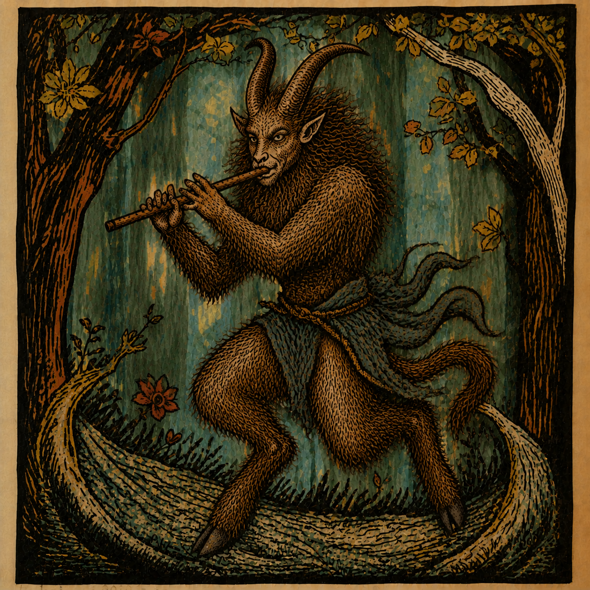

# FAUN

<p align="center"></p>

**F**ind · **A**cquire · **U**nify · **N**ormalize

A simple, clean desktop front-end for **ffmpeg**, **yt-dlp** and **mpv**. Works on macOS and Windows.
Trim, convert, compress and tidy video and audio files, download from many sites, and play your files
with a live VU meter, without typing a single command.

Created by Tomas Hajek · Version 1.0

> FAUN is an independent project. It is **not affiliated with or endorsed by** the FFmpeg, yt-dlp
> or mpv projects. "FFmpeg" is a trademark of Fabrice Bellard.

---

## What FAUN stands for

- **Find**: search and browse sites, channels and playlists.
- **Acquire**: download videos and music, one link or a whole list.
- **Unify**: clean file names, number files, write tags and cover art so a folder looks the same.
- **Normalize**: even out the loudness.

It also trims, converts and compresses files.

## What it does

| Tab | What you can do |
|---|---|
| **Setup** | Check, install and update the helper programs (ffmpeg, yt-dlp, mpv, deno, drag & drop support). |
| **Browse** | Search YouTube and other sites, open channels and playlists, play a video or song, add it to the batch. |
| **Quick download** | Paste one link and download it (video or audio, a part of it if you want). Playlist and channel links are handed over to Batch. |
| **Batch download** | A list of links and files. Each item goes through the steps you tick: Download, Convert, Compress, Remove audio, Extract audio, Loudness, Clean name, Write tags. Add an artist to the start of names, number the files, set the album tag. |
| **Files** | Two folders side by side: copy, cut, paste, rename, move to Trash, find duplicates, search in each folder, play files, send them to the other tabs. |
| **Trim** | Cut a part of a video or audio file, with a preview. |
| **Convert** | Change format, quality or codec. |
| **Compress** | Make files smaller (by quality, resolution or target size). |
| **Extract audio / Remove audio** | Save only the sound, or the picture without sound. |
| **Loudness** | Even out the volume of a file. |

Also:

- **Cover and tags panel** at the bottom of every tab: the cover, title, artist and album of the file you select.
- **VU meter** next to it, for the Files tab player: lit bars or analogue needles (click *Bars* / *Needle* to switch).
- **Clean file names**, tag writing (ID3v2.3 + ID3v1 for mp3, so car radios read them), embedded cover art.
- **Dark and light mode**, English and Czech (switch in the top right corner).
- GPU / hardware encoding when your computer supports it (VideoToolbox, NVENC, QSV, AMF).

---

## Requirements

- **Python 3.8 or newer** with tkinter (included with the python.org installers).
- **ffmpeg** (with ffprobe). **yt-dlp** is needed for the download and Browse tabs, **mpv** for playing files.
- Optional: `tkinterdnd2` for drag and drop of files, **deno** (helps yt-dlp with YouTube).

The **Setup** tab installs or updates all of them for you (Homebrew on macOS, Chocolatey on Windows).
You can also install them yourself.

## Run from source

```bash
python3 FAUN.py
```

## Build an app

**macOS**

```bash
python3 -m venv venv
source venv/bin/activate
pip install pyinstaller tkinterdnd2
rm -rf build dist
pyinstaller --windowed --noconfirm --clean --name "FAUN" --icon FAUN.icns \
  --collect-all tkinterdnd2 FAUN.py
codesign --force --deep --sign - dist/FAUN.app
open dist/FAUN.app
```

**Windows** (PowerShell)

```powershell
python -m venv venv
.\venv\Scripts\python -m pip install -q pyinstaller tkinterdnd2
.\venv\Scripts\python -m PyInstaller --windowed --onefile --clean --noconfirm --name FAUN `
  --icon FAUN.ico --add-data "FAUN.ico;." --collect-all tkinterdnd2 FAUN.py
```

The result is `dist\FAUN.exe`.

---

## Settings and data

The app remembers its settings and the batch list in a small folder of its own:

- macOS: `~/Library/Application Support/FAUN/`
- Windows: `%APPDATA%\FAUN\`

Delete that folder to start from scratch. (Earlier versions, called FFmpegUI, used a folder of that name; FAUN copies its settings once.) Files are never changed without you pressing a button; the
"Delete the original" option in Batch only removes a file after its processed copy has been saved.

## Privacy

FAUN has no account, no tracking and sends nothing to its author. It connects to the internet only
when you download, browse or install tools (through yt-dlp, Homebrew or Chocolatey). If you pick a
browser in the sign-in setting, yt-dlp reads that browser's cookies on your computer, for example for
age-restricted videos.

---

## Third-party software

FAUN does **not** contain these programs. It starts them as separate programs that you install
yourself (the Setup tab can do it). Their licences apply to them.

| Program | Used for | Licence (check the version you install) |
|---|---|---|
| [FFmpeg](https://ffmpeg.org) | converting, trimming, analysing, writing tags | LGPL 2.1+ or GPL, depending on how your build was compiled |
| [yt-dlp](https://github.com/yt-dlp/yt-dlp) | downloads and Browse | Unlicense |
| [mpv](https://mpv.io) | playing files | GPL 2+ or LGPL 2.1+, depending on the build |
| [deno](https://deno.com) (optional) | JavaScript runtime for yt-dlp | MIT |
| [tkinterdnd2](https://github.com/Eliav2lar/tkinterdnd2) (optional) | drag and drop | MIT |

Please download only content you have the right to download, and follow the terms of the sites you use.

## Licence

FAUN is free software, released under the **GNU General Public License, version 3 or (at your option)
any later version** (GPL-3.0-or-later). See [LICENSE](LICENSE). You may use, study, change and share it;
if you share a changed version, it must stay under the same licence with its source code.

Notices for the programs and libraries FAUN works with are in [THIRD_PARTY_NOTICES.md](THIRD_PARTY_NOTICES.md).

Copyright © 2026 Tomas Hajek
